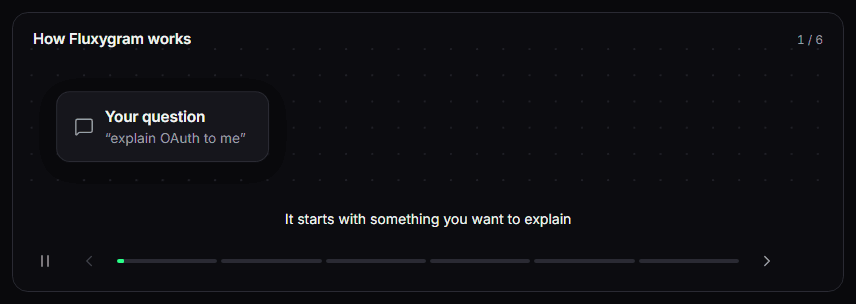

# Fluxygram for Obsidian

Animated diagrams that explain themselves, right in your notes. Write the diagram JSON in a `fluxygram` code block and it plays step by step: blocks appear, particles travel along each connection and the camera follows the story.

<p align="center">
  
</p>

## Usage

````markdown
```fluxygram
{
  "type": "flow",
  "title": "Password reset",
  "nodes": [
    { "id": "ask", "label": "Forgot password", "icon": "user" },
    { "id": "mail", "label": "Email with link", "icon": "mail" },
    { "id": "new", "label": "New password", "icon": "lock" }
  ],
  "edges": [
    { "id": "ask-mail", "from": "ask", "to": "mail" },
    { "id": "mail-new", "from": "mail", "to": "new" }
  ],
  "steps": [
    { "show": ["ask"], "caption": "Someone forgets their password" },
    { "show": ["mail"], "flow": ["ask-mail"], "caption": "We email them a one-time link" },
    { "show": ["new"], "flow": ["mail-new"], "caption": "They pick a new one" }
  ]
}
```
````

The diagram works in reading view and live preview, and follows Obsidian's light or dark theme. If the JSON has a mistake, the block shows a short message saying what to fix.

- **Build diagrams visually** in the editor at [fluxygram.app/play](https://fluxygram.app/play), then copy the JSON into your note.
- **The format**, diagram types and storytelling tips are in the [docs](https://docs.fluxygram.app).
- **Ask an AI** to write one: the format is plain JSON, so any assistant can produce it.

Everything runs locally. The plugin makes no network requests.

## Install

From Obsidian: **Settings → Community plugins → Browse**, search for "Fluxygram".

Manually: download `main.js` and `manifest.json` from the [latest release](https://github.com/Fluxygram/fluxygram-obsidian/releases/latest) into `<vault>/.obsidian/plugins/fluxygram/`, then enable it under **Community plugins**.

## Development

```sh
npm install
npm run build   # writes main.js
```

The diagram engine is [`@fluxygram/element`](https://github.com/Fluxygram/fluxygram), bundled into `main.js`.

## License

MIT
